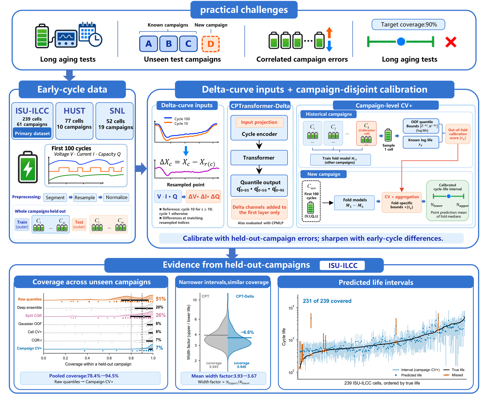

# delta-cp-battery

Cycle-life intervals for lithium-ion batteries tested under conditions the model has never seen.

Early-cycle life predictors are usually evaluated on cells from the same experimental campaigns they were trained on.
This code predicts a life interval from the first 100 cycles and evaluates it on entire held-out experimental campaigns.
On held-out ISU_ILCC campaigns, the common ways of getting an interval (raw quantile-head bounds, a deep ensemble, split
conformal calibration on randomly chosen cells) cover 78-88 % of cells for a 90 % target, clearly less than calibration
on campaign-disjoint residuals (about 94 %). The code has two parts:

* **Campaign-level conformal calibration.** A quantile head gives raw bounds; CV+ with campaign-disjoint folds and one
  calibration cell per campaign treats campaigns, not cells, as exchangeable. This holds within one data source; when
  the test cells come from another data source, no method here reaches the target coverage.
* **Delta-curve channels.** Inspired by the ΔQ(V) feature of Severson et al. (2019), every cycle's voltage, current and
  capacity curves are passed to the network together with their point-wise difference from a reference cycle (cycle 10
  for cycles >= 10, cycle 1 before). The difference is taken at the same resampled point index, not on a voltage grid.
  Relative to the quantile-head backbone, only the first layer changes.



## Layout

| Path | Contents |
|---|---|
| `delta_cp/data.py` | cache loading, campaign labels, Delta-curve channels |
| `delta_cp/model.py` | BatteryLife CPTransformer / CPMLP architectures with a quantile head, training and prediction |
| `delta_cp/conformal.py` | interval methods (campaign CV+ and baselines) and per-split metrics |
| `delta_cp/stats.py` | pooled metrics, cluster bootstrap over campaigns, paired tests, coverage gaps between methods |
| `scripts/extract_curves.py` | build the model-input cache from the BatteryLife `.pkl` files |
| `scripts/make_splits.py` | regenerate the outer splits in `splits/` |
| `scripts/run_split.py` | one outer split x backbone variant x seed |
| `scripts/run_all.py` | the full grid on one or more GPUs |
| `scripts/aggregate.py` | pooled results, every method vs campaign CV+, and the CPT-Delta vs CPT comparisons |
| `splits/` | the outer splits used in the paper and the list of cells (`cells.csv`) |
| `docs/framework.png` | overview figure |
| `third_party/batterylife/` | official BatteryLife model and resampling code (MIT License) |

## Installation

Python 3.11 and a CUDA GPU are recommended.

```bash
pip install -r requirements.txt
```

## Data

The data are not included. The code uses three subsets of the processed BatteryLife data (HUST, ISU_ILCC, SNL), available
from the BatteryLife repository (https://github.com/Ruifeng-Tan/BatteryLife) via Hugging Face
(`Hongwxx/BatteryLife_processed`) or Zenodo (record 19688272). Each subset is a folder of `.pkl` files; the life labels
are in the `Life labels` folder (`<SUBSET>_labels.json`).

Build the cache (repeat for `HUST` and `SNL`):

```bash
python scripts/extract_curves.py --subset ISU_ILCC --data-dir <BatteryLife>/ISU_ILCC \
    --labels "<BatteryLife>/Life labels/ISU_ILCC_labels.json" --out cache --workers 8
```

The script reports whether every cell matches the cells used in the paper (`splits/cells.csv`, SHA-256 of each cell's
curve tensor): 239 ISU_ILCC cells in 61 campaigns, 77 HUST cells in 10 batches, 52 SNL cells in 19 conditions.

## Splits

`splits/{isu,hust,snl}.json` list, for every outer split, the training, test, inner validation and CV+ fold cells, all
disjoint by campaign:

| File | Outer splits | Campaign | CV+ folds | Calibration unit |
|---|---|---|---|---|
| `isu.json` | 20 (5-fold group K-fold over 61 campaigns, 4 repeats) | ISU_ILCC group | 5 | campaign |
| `hust.json` | 45 (every pair of the 10 batches held out) | HUST batch | 4 (2 batches each) | cell (only 8 training batches) |
| `snl.json` | 20 (5-fold group K-fold over 19 conditions, 4 repeats) | SNL condition | 5 | campaign |

`python scripts/make_splits.py --data-dir cache --out <dir>` regenerates them.

## Running

One job (about one minute on an NVIDIA H20):

```bash
python scripts/run_split.py --dataset isu --split r0f0 --variant CPT-Delta --seed 2021 --data-dir cache
```

Variants: `CPT` (official CPTransformer architecture with the quantile head), `CPT-Delta` (with Delta-curve channels),
`CPMLP`, `CPMLP-Delta`. BatteryLife trains its models with the MSE on raw life and gives no interval; here every
variant is trained with the pinball loss on standardised log life.

The full grid of the paper (3 datasets x outer splits x CPT, CPT-Delta, CPMLP x seeds 2021, 42, 2024 = 765 jobs):

```bash
python scripts/run_all.py --data-dir cache --gpus 0 1 2 3 --workers-per-gpu 3
python scripts/aggregate.py
```

`aggregate.py` writes `results/summary.json` and `results/summary.md`: per-method tables, every method against
`campaign_cvplus` on the same records (coverage and share of under-covered campaigns, paired cluster bootstrap), and
CPT-Delta against CPT.

With torch 2.0.1+cu118 on NVIDIA H20 GPUs the runs reproduce the paper's numbers exactly; other GPUs or library
versions can change them slightly.

## Interval methods

All intervals are on log life for alpha = 0.1 (90 % target). The interval width factor is exp(U - L), the ratio of the
upper to the lower life bound.

| Name | Method |
|---|---|
| `campaign_cvplus` | CV+ on one calibration cell per calibration unit (the proposed calibration) |
| `cell_cvplus` | CV+ on every calibration cell |
| `cqr_r` | `campaign_cvplus` with the score divided by the quantile-head width |
| `split_cqr` | split conformalised quantile regression: one model on a random 60 % of the training cells, calibrated on the other 40 % |
| `gauss_oof` | Gaussian band from the standard deviation of the out-of-fold residuals (campaign-disjoint folds) |
| `deep_ensemble` | five models differing only in seed (dropout is 0); mean quantile bounds widened by z x SD of the members' medians |
| `qr_uncalibrated` | raw quantile-head bounds, averaged over the CV+ fold models |

The point prediction is the mean of the fold models' medians. Notes on the design:

* The epoch budget e* is chosen by early stopping on the inner validation campaigns. These cells are part of the
  training set and later also serve as CV+ calibration cells, so their labels are used once for choosing e*.
* `split_cqr` and the deep ensemble reuse e*, which was chosen for about 80 % of the training cells, although they are
  trained on 60 % and 100 % of them.

## References

* Tan et al., BatteryLife: A comprehensive dataset and benchmark for battery life prediction, KDD 2025.
* Severson et al., Data-driven prediction of battery cycle life before capacity degradation, Nature Energy 4, 383-391
  (2019).
* Barber et al., Predictive inference with the jackknife+, Annals of Statistics 49, 486-507 (2021).
* Dunn, Wasserman and Ramdas, Distribution-free prediction sets for two-layer hierarchical models, JASA 118,
  2491-2502 (2023).

## License

MIT (see `LICENSE`). `third_party/batterylife` keeps its own MIT License.
